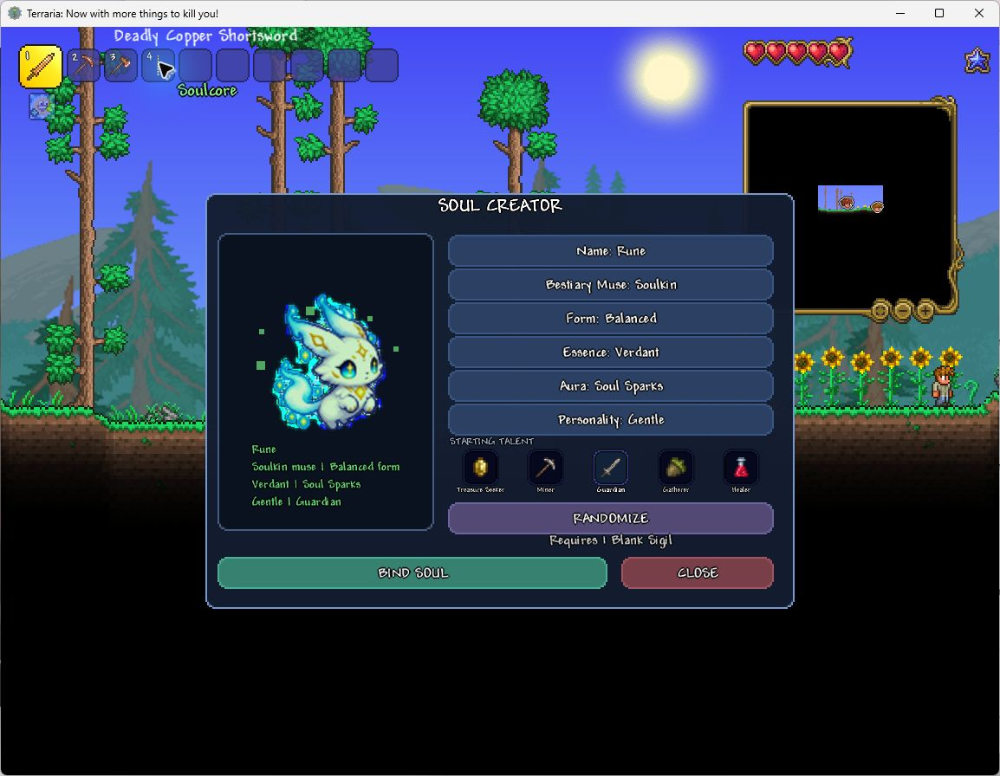
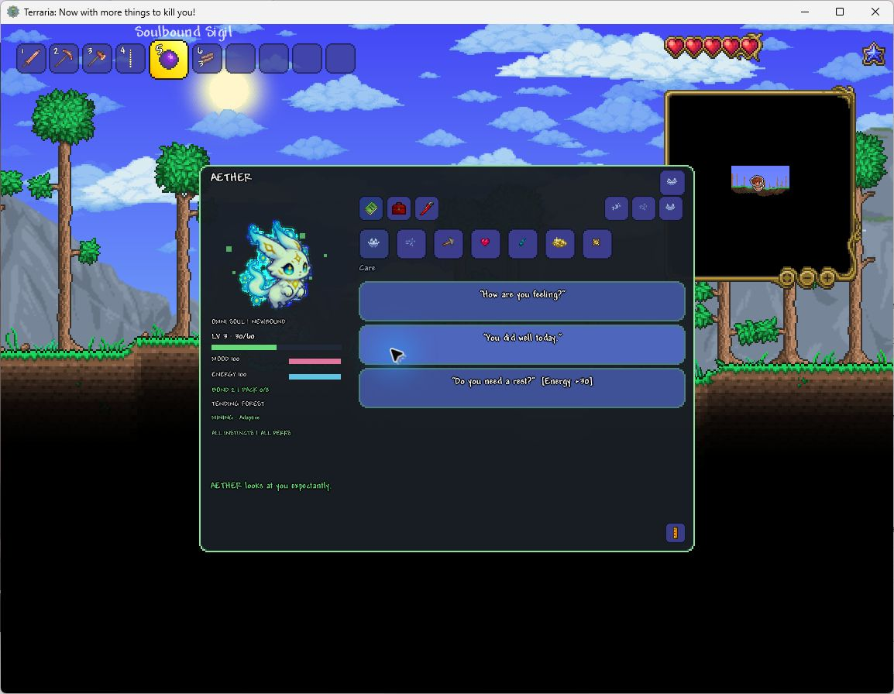
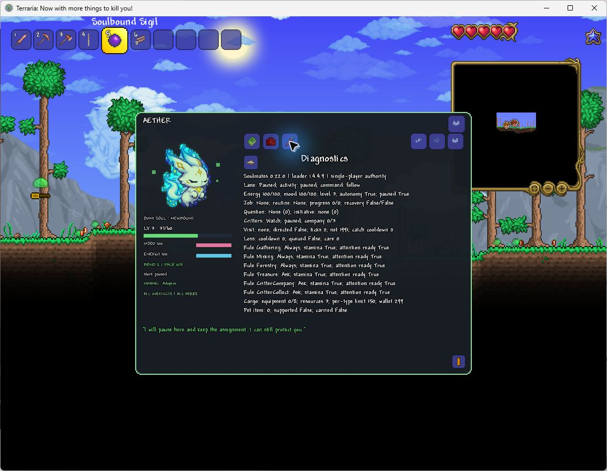

# Soulmates
## 0.27.0 - Behind the Curtain | Beta

Create a companion, give her a name and a place in your world, and grow together. Soulmates combines a reusable creator, persistent personalities, useful work, native-symbol Soulwheels, memories, pets and her own summoned company.

[Steam Workshop](https://steamcommunity.com/sharedfiles/filedetails/?id=3807130821) | [GitHub release](https://github.com/reirao/Soulmates/releases/tag/v0.27.0) | [Terraria forum](https://forums.terraria.org/index.php?threads/152194/) | [Bug reports](https://github.com/reirao/Soulmates/issues)

# YOUR COMPANION CAN BECOME THE BOSS

**Yes, her. The same companion, with the same memories and inventory.**

Turn on **EVIL** using the native angry-face symbol directly on her wheel. Then open **Games > secret eye**. One click shows the warning; a second confirms a real owner-only boss duel. She grows, displays HP, pauses before dashing and fires increasingly broad patterns across three health phases. There is a two-second opening before her attacks.

**Your character can take real damage.** There is no loot or XP reward, terrain destruction or permanent companion death. Her familiar and retinue rest during the duel. Other players, residents, critters and other companions are excluded from the challenge.

**Stop safely:** Games > Stop, Commands > Abort/Pause, EVIL off or recall. Victory, owner loss/death, distance, a five-minute timeout or another world boss also ends it. Her inventory and memories survive; challenge shots and debuffs clear. **Work stays paused until Resume.** EVIL by itself remains theatrical expression, not permission to attack or destroy things.

The creator reports a delighted installed 0.27.0 playtest. [Publication verified](tests/PUBLICATION-0.27.0-2026-10-12.md): GitHub distributes the exact independently retested Steam-managed package; both Workshop descriptions, the single current changelog and existing forum post/title are updated. This is encouraging real-player feedback, not complete progression, endurance or connected-multiplayer certification. Check the actual loaded version under Mods; Steam moderation remains pending and subscriber delivery is separate. [Release notes](releases/0.27.0.md) and [beta gates](BETA.md) describe the current scope.

## Start Together

1. Enable Soulmates in tModLoader 1.4.4 and reload. All multiplayer peers need **0.27.0**. Avoid duplicate local packages.
2. Characters receive a Soulcore and three Blank Sigils once. Replacements are craftable.
3. Use the reusable Soulcore or right-click it in inventory. Choose a companion and bind a Sigil.
4. Summon her with that Sigil and keep it in your inventory. One active companion per player; switching retires the old effects. Up + right-click the Sigil recalls her.
5. Right-click her for companion tools; yourself for the player wheel. **Details** opens conversation, equipment and diagnostics; **Pets** and **Pack** also open directly.

If she waits, check Stay/Pause, current assignment, autonomy, the ability's permission, mood and energy. Watch does not catch. Recovery rebuilds a reserve after exhaustion. The optional Details shortcut reports its actual binding; no fixed key is guaranteed.

## Create And Grow

- Choose name, personality, talent, essence colors, aura and Soulkin, Bunny, Blue Slime, Bird or Squirrel appearance. The creator has an animated preview; the original Soulkin uses eight frames.
- Identity, learned preferences, memories, equipment, pets and progression live on the persistent Soulbound Sigil. Existing Sigils migrate; keep the active one with you.
- **Open-ended levels and exact XP** continue beyond level 20 on the original quadratic curve. Five bond ranks, mood, naturally recovering energy and talent insights give growth different meanings.
- Growth is not unlimited power. Resources cap at 1,000 per type from level 20; ordinary retinue remains capped at three distinct staff types.
- A companion named **AETHER** is an Omni Soul with all starting talents and learned perks.

## Wheels And Control

- Compact companion and player Soulwheels use Terraria's own symbols. Player Emotes exposes all 151 vanilla emotes in crescent categories: Feelings, Gestures, Activities, Items, World, People & creatures and Notifications, with subcategories and paging.
- Companion Bond separates Feelings, Gestures and Care. Items opens categorized cargo conversations; Games contains Rock, paper, scissors and the optional confirmed boss challenge.
- **Terraria** is the default mouse mode: native inventory, NPC, chest, cursor-item and alternate-item actions retain priority. A workbench right-click opens inventory/crafting.
- **Me/Soulmate** explicitly arms contextual world pointing. Look observes without rewards or changes; Gather, Mine, Forest and eligible critter actions capture the original live target. Right-click inside the wheel cycles modes; X/Escape exits.
- **Config** changes work settings; **Last** repeats the last accepted intent per Sigil. Pointed repeats ask for a fresh target. Settings, failed orders and Look do not replace Last or grant automatic permission.
- **Pause** keeps work; **Resume** continues; **Abort** cancels and holds automatic work. Defense remains available outside the boss duel.

## Useful Work

- Follow, idle, inspect, catch up or Stay at a true world anchor. Defense handles nearby threats without spending work energy; Guardians reach farther and react faster. Healer support uses energy.
- Retrieve real usable drops, auto-collect mining output, locate nearby treasure and finish eligible area work before reporting completion. Useful carried weapons, torches, food and recovery items influence existing abilities. Occasional recipe suggestions use carried materials.
- Mining recognizes vanilla/modded ore metadata, tools and progression. Observed safe natural materials can be learned. **Adaptive, Tunnel, Vein and Surface** offer distinct approaches.
- Mining Config includes paged per-material automatic permissions, compass Up/Right/Down/Left/automatic route and bounded Short or next-opening tunnels. Cardinal tunnels are bounded to 8/24 steps, further limited by work radius. Plants, saplings, decorations, liquids and unstable/protected terrain retain safety checks.
- The **Forester** perk shakes eligible trees, clears natural fallen logs, gathers seeds and replants real carried acorns. Bare-branch pruning is limited to verified vanilla side-twig frames, not every tree family.
- Energy/mood recover naturally. Work effort costs one energy per eight retrieved stacks, four mined blocks or two forestry actions. Exhaustion rebuilds a 30-energy reserve before retained/automatic work resumes; combat pauses recovery.
- Companions illuminate nearby darkness and reveal the world map around themselves. Craftable Starfinder Bell, Delver Charm and Hearth Ribbon alter existing capabilities.

## Personality And Memory

- A shared attention selector weighs proximity, talent, observed habits and waiting time. Combat, explicit work, Stay and recovery take priority; repeated drops cannot indefinitely starve other eligible tasks.
- **Ask/Always/Never** is independent for gathering, mining, forestry, treasure, Company and Collect. Yes allows one opportunity. Learning preferences never silently grant permission.
- Observations, accepted requests and actual outcomes shape bounded per-Sigil preferences. Occasional evaluations use the native-symbol answer wheel; Later, silence and cancellation are neutral. Quiet disables personal evaluations.
- In safe idle moments she can visit a classified nearby home, keep her real familiar company or reflect on observed building supplies. Only completed undertakings become memories after return. This is not autonomous construction or copied architecture.
- **Home** uses Terraria's house symbol to classify a valid shelter: our home, her little home, just a stop or Later. Room, actual bed and resident housing are different evidence. Familiarity is not ownership; changed rooms/worlds are rechecked. Recognized home chests are not automatically rediscovered as treasure.
- NPC greetings, observed native emotes and personality-aware replies build bounded world-scoped resident relationships. "Do you remember?" tells short chapters from actual saved events, with truthful present observations if no story matches.
- Speech, native emotes and small combinations share attention rather than talking over questions. Mood, energy, bond, personality and chosen voice affect replies and explained refusals.
- Rock, paper, scissors uses independently chosen moves and native symbols, including normal player RPS emotes. It grants no XP and does not replace assignments. Other minigames are not implemented.

## Critters And Company

These are separate systems, not interchangeable pet slots:

- **Watch** greets nearby natural critters without catching. **Company** temporarily invites supported real bunnies, squirrels, birds, butterflies, fireflies and lightning bugs: one for ordinary companions, up to three for AETHER. Native physics, catching, damage and despawning still apply. No spawned copies or teleporting stragglers.
- **Collect** includes ordinary basic-net capability, not a free withdrawable net item. Lava species need an eligible carried lava-proof net. Gold, statue-spawned and player-released critters are protected. Distance, visibility, tasks, stamina and separate consent still matter.
- Nearby witnessed deaths can provoke sorrow/apology and stronger disapproval when native player attack credit exists. Unknown causes do not accuse a player; catching is not death. Reactions are bounded and may wait behind speech. Individual live timing still needs feedback.
- **Pets** has twelve real owned-item slots. The upper gift row is still your inventory; the lower row is hers. Give an unfavorited reusable pet item, left-click an owned slot to summon, right-click to return. The first gift selects only into empty storage; later gifts respect dismissal. Wheel icons select, not duplicate.
- One harmless familiar follows separately from your own pet. Registered item/buff/projectile metadata supplies native animation and basic light with custom movement, not original player-pet AI, special utility or arbitrary modded drawing.
- **Retinue**, opened with the staff symbol in Pets, stores real gifted reusable summon staves. Ordinary companions select 1/2/3 distinct types at levels 1/10/20; **AETHER selects every owned distinct type simultaneously**, within 64 item slots. Duplicates do not multiply helpers. Native art uses bounded companion combat, not original minion AI. Your buffs and summon slots remain separate.
- AETHER's cosmetic insect flock represents up to six actual carried insects; returning them removes their representation. No free critters or combat army are created. Recall, switching, dismissal and final withdrawal clean up bound effects.

## Cargo And Character

- **Equipment:** 8-12 slots through bond/trinkets, 99-unit reserve per item type. Tools shown in Details are capabilities, not a generic armor system.
- **Resources:** 60 stack slots, pages of 12; 50 units per level/type, 500 at level 10 and a maximum of 1,000 from level 20. Native item stack limits still apply.
- **Wallet:** one exact copper-equivalent balance with no gameplay currency cap. Money occupies no cargo slots. Personality-specific "Here for you!" offers can share accumulated savings; anything that does not fit stays with her.
- Real-item transfers share capacity, identity and ownership rules. Cargo left-click returns a stack, right-click one item. Wallet icons withdraw bounded native denominations. Existing excess is returned safely, not silently deleted.
- **Details** separates Conversation, Equipment and read-only Diagnostics with portrait/vitals and a reply strip. Diagnoses distinguish busy, permission, recovery, targets and client/server state. Explicit wrench export stays local.

## Under The Hood

No online AI service runs in Soulmates. "Learning" means bounded local game systems, not a remotely thinking or sentient agent.

- Partial NPC modules cover work, combat, social behavior, places, pets and retinue. A shared activity/attention coordinator and registered ability policies connect them; they still share NPC state and are not a fully pluggable engine.
- Sigils own persistent profiles. Live targets, questions and effects bind to owner/companion identity; servers validate requests and reject foreign, stale, conflicting or replayed actions.
- XP uses arbitrary-precision integers and an exact integer square root. Growth remains separate from balance caps. Legacy int saves migrate; current transport validates the extended XP payload.
- The boss challenge transforms the same NPC temporarily. A session token binds each hostile spark; engine-native hostile ownership is separate from its allowed target. Returning restores friendly/invulnerable state, clears attacks and debuffs, and awards no loot or XP.
- Pets and retinue retain real item ownership while drawing native sprites with bounded custom behavior. They are not extra player buff slots or promises of every vanilla/modded minion ability.
- Engine probes exercise native NPC/projectile updates, inventory transactions, UI handlers and server packets. A separate audit tries adversarial paths. These are valuable counterchecks, not a substitute for rendered gameplay or two connected clients.

## Verification And Honesty

0.27.0 passes **116,213 native assertions**, **501 independent audit expectations** and **60,730 static/localization assertions**, with **1,036 keys in nine catalogs**. Production compilation has zero warnings/errors. The test probe retains 33 existing nullable/Hjson warnings. [Exact candidate checks](tests/ENDLESS-BOSS-0.27.0-2026-10-12.md) and [installation receipt](tests/CLIENT-INSTALL-0.27.0-2026-10-12.md) keep identities and initial failed cases visible.

The creator's successful 0.27.0 playtest is separate evidence. Full GUI families, physical inputs, later progression, long sessions, other-mod interactions and connected multiplayer remain open. [BETA.md](BETA.md) and [VERSIONING.md](VERSIONING.md) define acceptance, not an unagreed future roadmap.

### The V Key Lesson

We advertised V without a real end-to-end keypress test. A software trigger proved the handler, not the physical key. **That claim is withdrawn, not promised fixed.** The Sigil reports its actual assignment; use **Details/Pets on her wheel**. This stays as a small monument to an assumption we did not fully test.

### Development Diary

We sometimes grew features faster than we checked their complete interaction. Cargo bugs produced acorn/Gel piles; unlike stacks could merge incorrectly. Critter logic mistakenly used temporary spawn protection as permanent species classification. Visible buttons were not proof of finished behavior. Versions, repeated logs and old footage confused publication. Those failures prompted shared transfer rules, live identity checks, consent registration, repeated independent audits and exact package comparisons. A recent boss test also caught native ownership resetting hostile-projectile AI fields before the real-engine countercheck passed.

The [complete changelog](CHANGELOG.md) and version-specific reports preserve that history. [changelog.txt](changelog.txt) contains **only this update**, so older logs are not republished. [0.26.0 publication](tests/PUBLICATION-0.26.0-2026-10-11.md) remains historical evidence, not proof of 0.27.0 subscriber delivery.

## Feedback And Privacy

I have limited time to play and progress slowly through Terraria. Please report version, action, expected/actual result and solo/MP. Language corrections, balance observations and stories of a companion making you smile are welcome.

The paper-plane icon or `/soulfeedback` opens the local **AETHER Mailbox**. Optional Field Notes start off. Automatic notes omit account/player/character/world names, chat and exact coordinates; place coordinates remain in the game save. Typed notes keep your own text, up to 360 characters. Nothing uploads or automatically reaches the developer. Share only the specific report you choose.

Local notes live in `SoulmatesFeedback`: a bounded session journal, summary, bug inbox and typed-note inbox. Failed writes retain bounded context and do not clear an unsaved manual note. `/soulfeedback off` stops future recording; existing files remain yours.

## Languages And Assets

English, German, Italian, French, Spanish, Russian, Brazilian Portuguese, Polish and Simplified Chinese follow Terraria's language selection, with English fallback. Catalogs are complete; AI-authored translations need native-speaker corrections. Some MP replies use the server language; technical diagnostics remain English. [Localization maintenance](tests/localization/README.md).

Extensive AI assistance was used for programming, writing, UI and visuals. Mod/Workshop icons and original Soulkin art are AI-generated; other creature, item, inventory and emote graphics reuse Terraria assets. The project is about companion systems, not an online generative service.

## Genuine Gameplay

The [October 5 Classic showcase](media/current/showcase-0.22.0/README.md) contains 20 genuine unaltered **0.22.0** captures, including the bugs that prompted repairs. **They are historical images, not current boss footage.** New screenshots/video will be updated gradually as spare time allows.

The [earlier creator gallery](media/current/README.md) preserves October 1 screenshots/video frames. Gallery assets are excluded from the mod.

## Development And Recipes

Install Terraria/tModLoader through Steam, clone into `Documents/My Games/Terraria/tModLoader/ModSources/Soulmates`, then use **Workshop > Develop Mods > Build + Reload**. Elsewhere set `TML_PATH` to the tModLoader 1.4.4 stable installation and use the documented [test/build routes](tests/README.md).

- **Soulcore:** 8 Fallen Stars, 5 Amethyst, 10 Stone Blocks at a Work Bench.
- **Blank Sigil:** 3 Fallen Stars, 1 Amethyst, 5 Silk at a Work Bench.
- **Starfinder Bell:** 5 Fallen Stars, 3 Iron/Lead Bars, 1 Lens at an Anvil.
- **Delver Charm:** 5 Iron/Lead Bars, 2 Amethyst, 20 Stone Blocks at an Anvil.
- **Hearth Ribbon:** 5 Silk, 2 Daybloom, 2 Fallen Stars at a Work Bench.

## License
MIT
